<p align="center">
  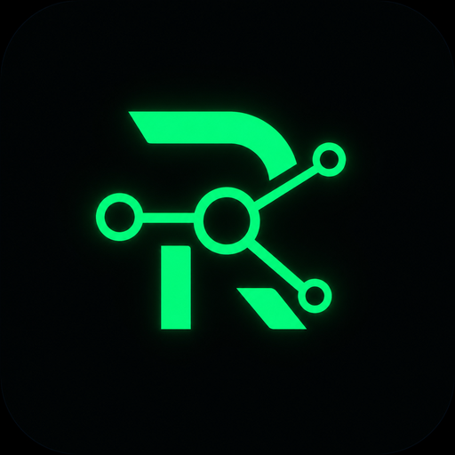
</p>

<h1 align="center">Rokid Nexus</h1>

<p align="center"><b>Install a phone app, get a glasses app.</b></p>

<p align="center"><a href="https://rokid-nexus.anezium.me">rokid-nexus.anezium.me</a></p>

<p align="center">
  <a href="https://github.com/Anezium/Rokid-Nexus/releases"></a>
  <a href="https://github.com/Anezium/Rokid-Nexus/releases?q=sdk"></a>
  
  
  
  <a href="LICENSE"></a>
</p>

<p align="center">
  <a href="https://ko-fi.com/anezium" target="_blank">
    
  </a>
</p>

Rokid Nexus is a plugin platform for Rokid AR glasses: one permanent hub lives
on the glasses and renders everything; all features ship as ordinary Android
APKs on the phone. Plugins need no separate APK on the glasses.

## What you see on the glasses

Nexus draws everything itself, from what plugins describe. Four words cover
most of it, and each one is shown, animated, in the
**[visual glossary](docs/GLOSSARY.md)**.

<table>
  <tr>
    <td align="center" width="25%">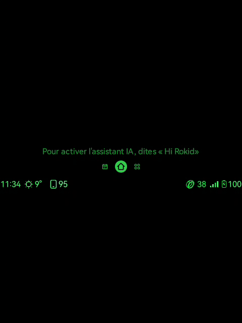</td>
    <td align="center" width="25%">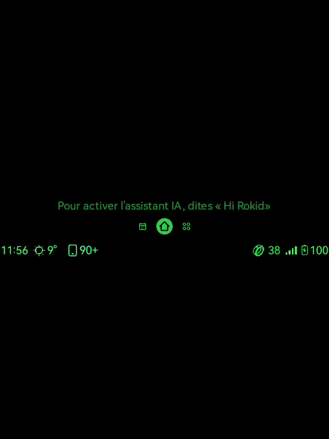</td>
    <td align="center" width="25%">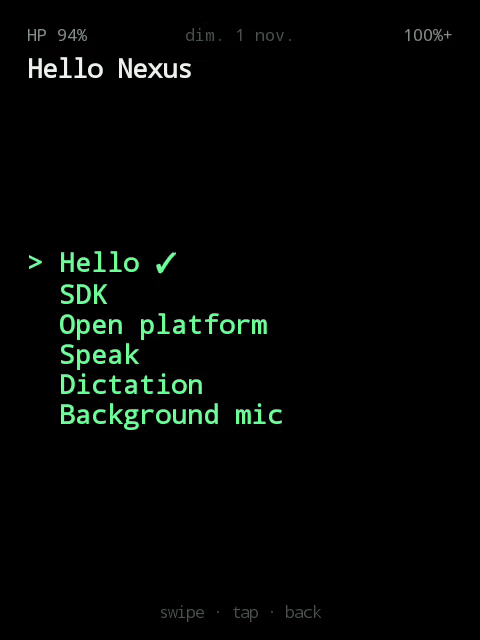</td>
    <td align="center" width="25%">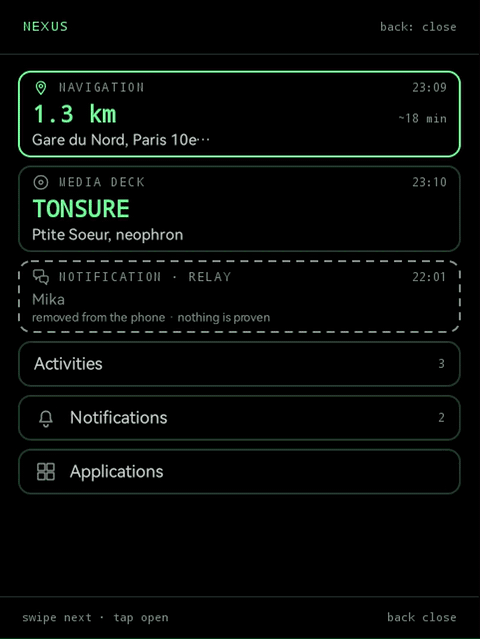</td>
  </tr>
  <tr>
    <td valign="top"><b>Launcher</b> — triple tap: live <b>Activities</b> cards first, then Notifications and Applications</td>
    <td valign="top"><b>Island</b> — an activity floating over whatever is in front, the Rokid home included</td>
    <td valign="top"><b>Band</b> — a notice: a message or an answer that arrives, asks one thing, and leaves</td>
    <td valign="top"><b>Page</b> — what a card opens inside Nexus: a conversation, a player, a route, a checklist</td>
  </tr>
</table>

A plugin's own full-screen interface is its **immersion**, one tap away under
**Open app**. A **pin** keeps a static fact in a corner.

Whether an island floats is the wearer's choice, per plugin, on the phone:
**Floating Activities** offers Automatic, Always visible, Home screen only, On
changes (3, 5 or 10 seconds per real event) or Activities only. The island
expiring never ends the activity; its card stays in the launcher.

## Nexus 2.0

Update **both hubs to 2.3.0**, plus Relay 1.4.2, Navigation 0.3.0, Media Deck
1.0.4 and Sample 1.0.6. Plugin developers use SDK 0.25.0. See the
[2.3.0 release](https://github.com/Anezium/Rokid-Nexus/releases/tag/v2.3.0)
and [changelog](CHANGELOG.md) for downloads and compatibility details. The
**Classic launcher** stays available on the phone and the glasses, and older
hubs keep it automatically.

Nexus 2.2.0 plays the glasses' sound in your phone's earbuds when you want it,
puts up to four favourite applications on the glasses home, and lets plugins
add their own composer buttons, picture thumbnails, full-page pictures and row
icons. Meta Messages, a new plugin, brings WhatsApp, Instagram and Messenger
conversations to the glasses with it.

Plugins stay isolated in their own processes, appear only after explicit user
approval, and draw on the HUD through declarative contracts: cards, synced
timed lines, media decks, real images, typed pages and compiled interactive Ink
pages. They can also speak, listen, and see: speech in and out, and the glasses
camera, are platform capabilities the wearer grants one at a time and can take
back. And they can work for each other: with Skills, a plugin publishes typed
operations that an approved assistant invokes through the phone hub, each
operation allowed by the wearer on its own.

## Plugins

| Plugin | What it puts on the HUD |
|---|---|
| **[Assistant](plugins/assistant/)** | Hold the touchpad and ask out loud: your words appear as you speak them, then the answer arrives on the band, in your ear, or as a native Ink page with charts and interactive controls — and it can look through the glasses camera to tell you what you are seeing. Ask it to remind you, set a timer, or take a note, and it does: the phone rings at the hour and the glasses raise it. It can also add, read, and safely delete phone-calendar events, answer from a folder of documents on the phone — PDFs and images included, cited by file and page — and ask other plugins, such as Transit's departures or Media Deck's pause, through operations you approve. Runs on your own ChatGPT plan, or any AI provider you bring a key for — OpenAI, OpenRouter, MiniMax, DeepSeek, GLM, Hermes, or your own server |
| **[Relay](plugins/relay/)** | Phone messages as a band over whatever you were looking at; a message opens as a conversation page, answered by voice on the glasses or typed on the phone, and Send stays a separate tap — plus an inbox for the ones you let go |
| **[Meta Messages](plugins/meta/)** | WhatsApp, Instagram and Messenger conversations on the glasses: read them in one scrolling column, answer by voice or the phone keyboard, and take a photo and send it from the chat. An unofficial client, licensed AGPL-3.0 |
| **[Navigation](plugins/nav/)** | The route Google Maps, Citymapper, OsmAnd, Organic Maps or Yandex Maps is guiding you on, kept on the glasses as one live activity: the next turn and its distance, or the walk to the stop, the line to board and the stops left. Walks Nexus plans itself add a minimap island, a route page with its map, and a full-screen map |
| **[Lens](plugins/lens/)** | Google-Lens-style live translation: the glasses camera streams to the phone, ML Kit OCR + translation run there (offline), translated overlays come back in real time — plus a freeze mode for full-resolution stills |
| **[Feeds](plugin-feeds/)** | Bluesky and X timelines — browse posts, open threads, and view the actual photos full-screen |
| **[Transit](plugins/transit/)** | Nearby stops and live departures (Transitous/MOTIS), with favourites — and "take me home" guidance and departures Assistant can ask for |
| **[Lyrics](plugins/lyrics/)** | Time-synced lyrics for whatever is playing on the phone, from Spotify/Musixmatch/Netease/LrcLib |
| **[Media Deck](plugins/media/)** | Whatever plays on the phone as an activity: cover and scrolling title on its island, Previous / Play-Pause / Next on its launcher card, and a player page with progress; Assistant can ask what is playing and pause it |
| **[Photos Sync](plugins/photosync/)** | **Deprecated**: the Hi Rokid app now syncs glasses captures to the phone itself. Copied the photos and videos you shoot on the glasses into the phone gallery |
| **[Patcher](plugins/patcher/)** | Phone-only APK patching for YouTube and Reddit (Preview), with both guided setups in Patcher. Runs locally and returns verified output to the hub for installation |
| **[Wireless ADB](plugins/wireless-adb/)** | Enables Android's real wireless debugging service and creates a short-lived pairing command, so a trusted computer can connect to the glasses over the LAN without a cable or Settings automation |
| **[Tasker](plugins/tasker/)** | Your named Tasker tasks on the HUD — swipe, tap, and the phone runs the automation. The glasses are the remote, Tasker does the work |
| **[Sample](plugins/sample/)** | Minimal copyable reference plugin: a pin, a notice band, a demo route activity, Todo and Groceries pages, and a skill operation, all from the public SDK |

And eleven that are not in this repository at all, written by five other
authors against the same SDK and listed in the same Store:

| Plugin | Author | What it puts on the HUD |
|---|---|---|
| **[Lume](https://github.com/beyondlevi/lume-nexus)** | beyondlevi | A wearable speed reader: text arrives one word at a time at a fixed point, 150–700 wpm, with long words and sentence endings held a little longer. Import a PDF or a text file on the phone, read hands-free with the R08 ring |
| **[Agenda](https://github.com/beyondlevi/rokid-agenda-nexus)** | beyondlevi | The calendars your phone already syncs: what is next first, then the event's participants and description |
| **[News](https://github.com/beyondlevi/news-nexus)** | beyondlevi | RSS and Atom feeds: sources with unread counts, headlines newest first, articles paged |
| **[Tuya Smart Home](https://github.com/beyondlevi/rokid-tuya-nexus)** | beyondlevi | Your Tuya / Smart Life homes, rooms and devices — pick one and act on it |
| **[Shopping List](https://github.com/beyondlevi/nexus-shoplist)** | Volund | Your list on the HUD, ticked off with the ring, while you add to it on the phone — or paste a whole list and have every line become an item |
| **[Home Assistant](https://github.com/azhilin246/rokid-nexus-home-assistant)** | Zhilin | Configurable Home Assistant pages; the selected tile runs its action |
| **[OTPs](https://github.com/azhilin246/rokid-nexus-otps)** | Zhilin | One-time codes extracted from notifications, after explicit Android approval, as timed alerts plus a short history |
| **[Taxi Plate](https://github.com/azhilin246/rokid-nexus-taxi-plate)** | Zhilin | The active ride from supported taxi apps, with pickup or trip timing |
| **[RokidHub · Codex](https://github.com/lavAzza2/rokidhub-codex)** | Azat Akhmetshin | Coding tasks by voice, routed through RokidHub to Codex on your own machine |
| **[RokidHub · Yandex](https://github.com/lavAzza2/rokidhub-nexus-yandex)** | Azat Akhmetshin | Yandex Smart Home by voice, answered on the HUD and aloud |
| **[Zap](https://github.com/marcusalemao/Zap)** | Marcus de Magalhães | WhatsApp on the glasses: chats newest first, whole messages, heard again, answered or started by voice, with photos from the glasses camera |

They install and run exactly like the ones above, under the same grants and the
same identity checks. Nothing in the platform is reserved for first-party code.

All of them install from the in-app **Nexus Store**, backed by the public
[RokidBrew-Registry](https://github.com/Anezium/RokidBrew-Registry) feed with
SHA-256 and signer pinning enforced before every install, and show update
badges when a newer release is published.

**Glasses sound in earbuds**, in Settings under Voice, plays everything the glasses play — Hi Rokid's voice included — in the earbuds or headphones connected to your phone while the glasses stay quiet. It is off by default and needs both hubs 2.1.0 and the glasses command bridge.

The phone hub also controls software that is already installed on the glasses.
**Glasses apps** lists and opens launchable native APKs; **Keyboard & remote**
provides previous/next/select/back navigation and sends transient keyboard
deltas into the focused glasses editor, a plugin's own text field included; when
a plugin opens a field, the screen comes forward by itself and leaves once the
field is done. Password fields are marked sensitive,
the phone window becomes secure, and Nexus never mirrors the editor's existing
text. These are trusted hub-to-hub controls, not plugin capabilities.
**Patcher → YouTube** (the Patcher plugin's settings) guides the YouTube setup:
the hub downloads official Morphe MicroG-RE, takes the patched YouTube APK back
from Patcher or an explicit import, and installs or updates them over the Rokid link.
Glasses apps keeps listing and opening the installed YouTube like any native app.
Sign in on the glasses with the phone keyboard; account data stays in MicroG.
**Patcher → Reddit** works the same way, without MicroG, and is a Preview.
The glasses launcher lists native apps alongside phone plugins. See
[YouTube setup](docs/YOUTUBE_GLASSES.md) for APK requirements and validation.

## Screenshots

### Phone app

<p align="center">
  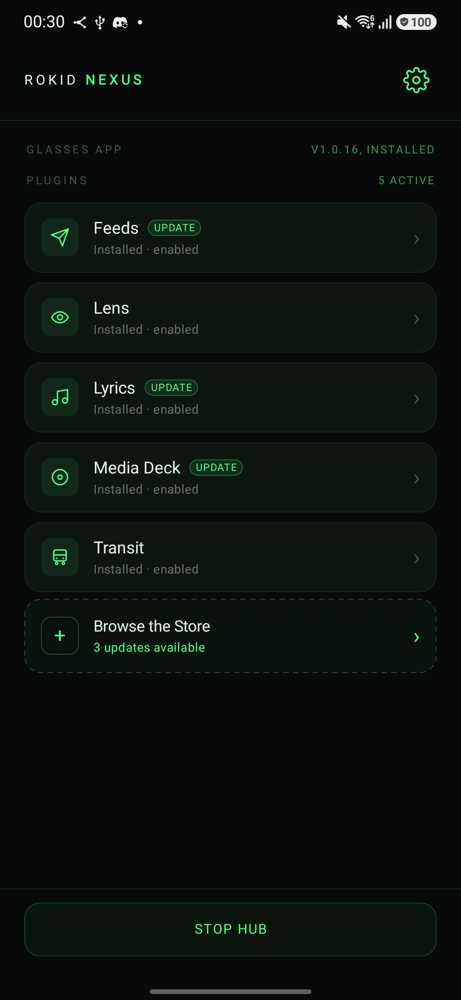
  &nbsp;
  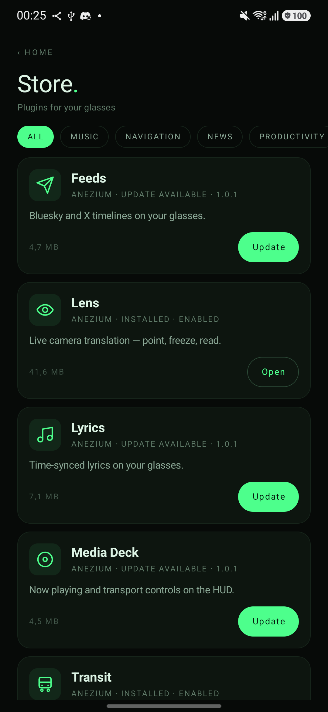
</p>

<p align="center"><i>The phone hub: your plugins, glasses-app status, and one-tap updates — and the Store they install from.</i></p>

<p align="center">
  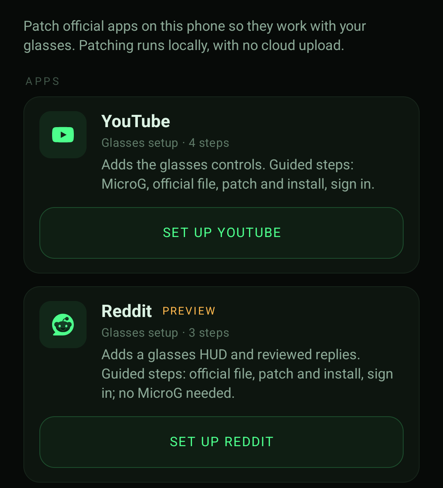
</p>

<p align="center"><i>Patcher — YouTube and Reddit are patched on the phone, then checked and installed on the glasses by Nexus.</i></p>

### Glasses launcher

<p align="center">
  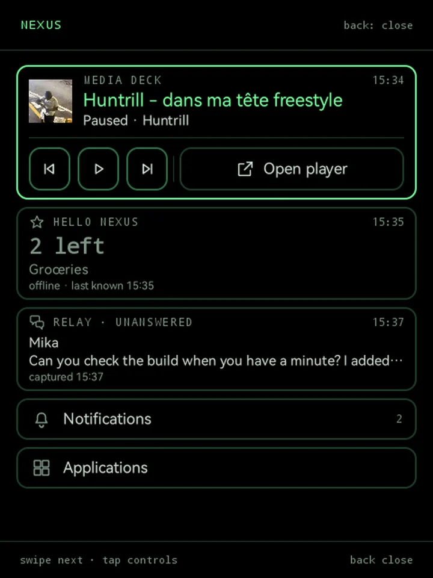
  &nbsp;
  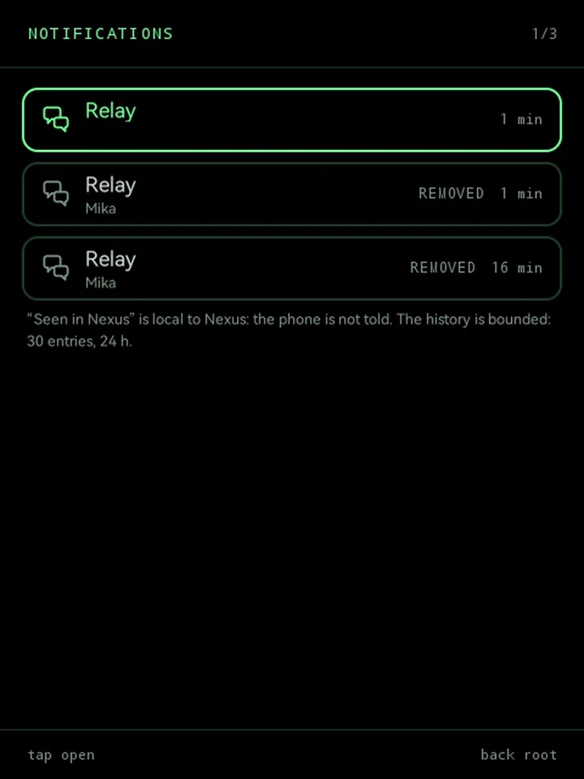
  &nbsp;
  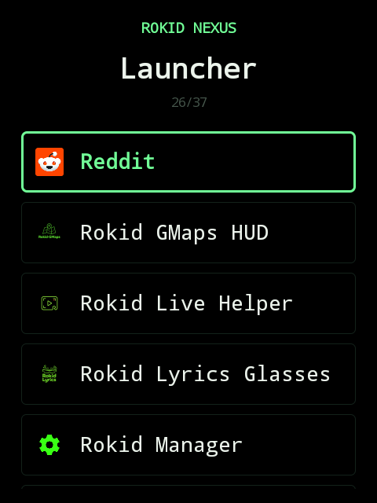
</p>

<p align="center"><i>Triple-tap the touchpad from anywhere to bring this up — the only gesture Nexus claims. Activity cards come first, with their quick controls; back returns to whatever was underneath. &nbsp;·&nbsp; The last 30 notifications of the past 24 hours, in memory only. &nbsp;·&nbsp; Applications lists the plugins and the apps installed on the glasses, with their own icons.</i></p>

### Plugins on the HUD

<p align="center">
  
  &nbsp;
  
</p>

<p align="center"><i>Relay — a message you can answer arrives as a band over whatever you were already looking at, sender kept on every line. &nbsp;·&nbsp; Anything you let go waits in Messages, newest first.</i></p>

<p align="center">
  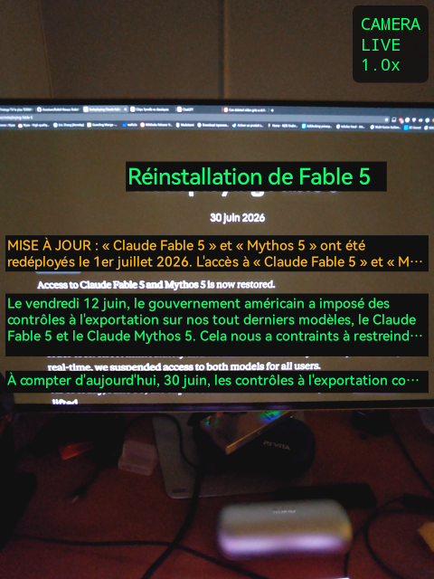
  &nbsp;
  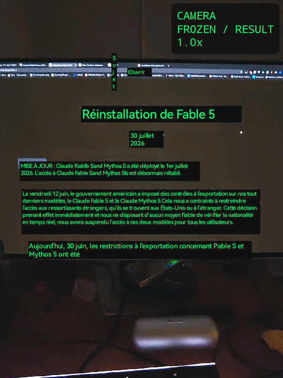
</p>

<p align="center"><i>Lens — live translation streamed to the phone and back, plus a freeze mode for full-resolution stills.</i></p>

<p align="center">
  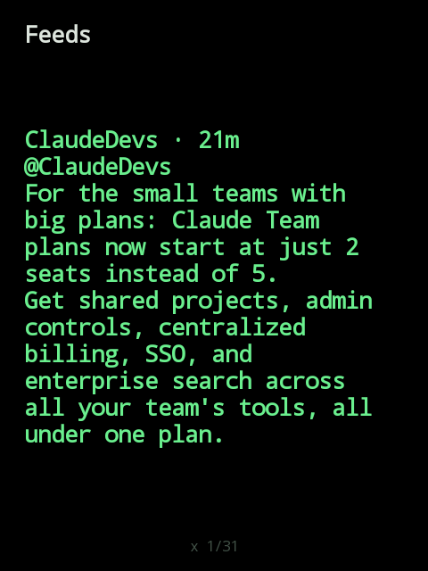
  &nbsp;
  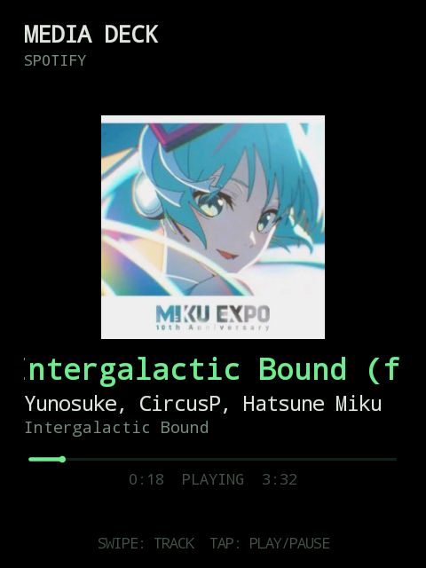
</p>

<p align="center"><i>Feeds — Bluesky and X timelines. &nbsp;·&nbsp; Media Deck — now playing with album art and transport.</i></p>

<p align="center">
  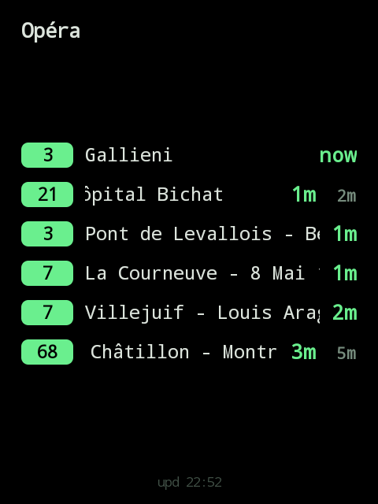
  &nbsp;
  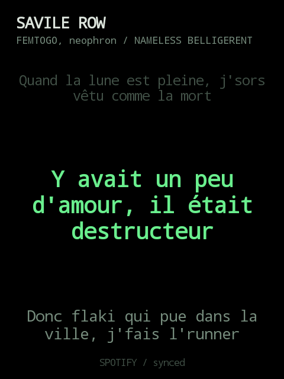
</p>

<p align="center"><i>Transit — nearby stops and live departures. &nbsp;·&nbsp; Lyrics — time-synced to whatever is playing.</i></p>

<p align="center">
  
  &nbsp;
  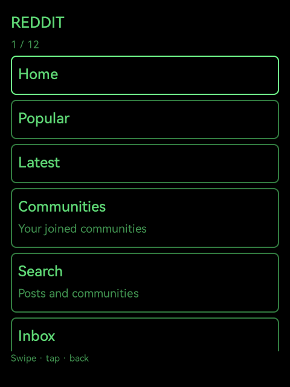
</p>

<p align="center"><i>YouTube, patched by Patcher for the touchpad and the ring. &nbsp;·&nbsp; Reddit, in Preview, with its own green HUD.</i></p>

## Setup — a phone is all you need

1. Install the Nexus phone app from this repository's
   [releases](https://github.com/Anezium/Rokid-Nexus/releases).
2. Follow the onboarding: seven in-context steps, including pushing the
   glasses app over the Rokid link — no cable, no PC.
3. On the glasses, enable the accessibility service when asked. Nexus
   bootstraps the rest of its glasses-side setup by itself.
4. Install your first plugin from the Store.

Both apps keep themselves current afterwards: the phone updates from GitHub
releases, the glasses update over the Rokid link, plugins update through the
Store.

## Trust and security

- **Nothing is granted by installation.** Any APK may ask for bus access, but
  every capability (`surfaces`, `ink_surface`, `http_proxy`, `microphone`,
  `stt`, `tts`, `camera`, `mediasync`, `assistant`, `wireless_debugging`,
  `skills_provider`, `skills_client`) is granted per plugin by the user, keyed
  to package, plugin id and signing certificate. Each skill operation needs one
  more approval per caller, and a changed operation starts disabled again.
- **Plugins never choose how loud they are.** They describe state; Nexus picks
  the island's form, the wearer picks whether it floats, and the trusted
  hub-to-hub controls (native apps, keyboard, navigation, pointer) are never
  plugin capabilities.
- **Verified installs.** The Store checks each plugin's SHA-256 and pins its
  signer. The glasses APK must match its release digest, package, version and
  one pinned certificate, verified with apksig even on Android 11 phones; see
  [glasses APK verification](docs/GLASSES_APK_VERIFICATION.md).
- **An authenticated link.** The phone and glasses hubs enroll a pairing key
  through the Hi Rokid-authorized CXR session, then authenticate every SPP
  frame with integrity and replay protection. A key mismatch fails closed;
  offline reconnects never create or replace keys. Until both hubs have
  authenticated, binary and large messages return `NO_DATA_PLANE`. The details
  are in the [wire specification](BUSSPEC.md#authenticated-spp-transport-v1).
- **A closed admin boundary.** The phone hub's exported service stays open for
  plugin binding, but administrative starts need a private, process-local
  Binder capability: external intents cannot stop the hub, replace its
  authorization or start a glasses install (see
  [TESTPLAN.md](TESTPLAN.md#phone-hub-command-boundary)).

Developer mode adds package, signer, protocol and route diagnostics plus a
live bus inspector.

## Build a plugin

A plugin is a headless phone APK against the published SDK:

```kotlin
repositories { maven("https://jitpack.io") }

dependencies {
    implementation("com.github.Anezium.Rokid-Nexus:bus-client:sdk-v0.25.0")
}
```

Start with the [visual glossary](docs/GLOSSARY.md) — pin, band, island, card,
page and immersion, each shown on the glasses with its SDK type — then
[plugins/AGENTS.md](plugins/AGENTS.md), the complete, self-contained plugin
contract, then [docs/PLUGIN_SDK.md](docs/PLUGIN_SDK.md)
(SDK reference) and [docs/PLUGINS.md](docs/PLUGINS.md) (structure + design
kit). [plugins/sample](plugins/sample/) is the canonical template. Publishing
is F-Droid-like: host the APK on your own releases, PR a manifest to the
registry ([plugins/README.md](plugins/README.md)).

## Repository layout

- `shared`: wire envelopes, paths, descriptors, capabilities, and route rules.
- `bus-client`: the public Android SDK — `NexusPluginService`, lifecycle
  callbacks, typed card/timed-lines/media/image surfaces, pins, notice bands,
  activities and launcher pages, compiled Ink sessions, speech in and out, skills for providers
  and callers, the NexusUi design kit, and explicit hub targeting.
- `ink-engine`: the bounded `.ink` compiler, data-binding engine, revisioned
  render document/patch codec, and strict compatibility limits shared by both
  hubs and the public SDK.
- `phone-hub`: discovery, consent, identity enforcement, skill routing, the
  Nexus Store, app self-update, trusted native-app/keyboard controls, and the
  Rokid link.
- `glasses-hub`: the single HUD renderer/launcher anchor, the camera platform,
  native Ink renderer, Nexus IME/navigation bridge, and no-PC self-arm onboarding.
- `plugins/` and `plugin-feeds/`: the plugin APKs, one folder per plugin with
  its README and CHANGELOG.
- `phone-client-probe` and `glasses-client-probe`: validation modules.

## Local build

Use JDK 17 and the checked-in Gradle wrapper:

```powershell
.\gradlew.bat test lintDebug assembleDebug
.\gradlew.bat :shared:publishToMavenLocal :bus-client:publishToMavenLocal '-PversionName=0.1.0-SNAPSHOT'
.\gradlew.bat :plugin-sample:assembleDebug '-PusePublishedSdk=true' '-PversionName=0.1.0-SNAPSHOT'
```

The local `CxrGlobal` composite is used only when its sibling directory exists.
SDK publication and the published-coordinate sample build do not require it.

## More

[Glossary](docs/GLOSSARY.md) · [plugin SDK](docs/PLUGIN_SDK.md) ·
[product vision](VISION.md) · [roadmap](ROADMAP.md) ·
[wire specification](BUSSPEC.md) · [protocol guide](docs/PROTOCOL.md) ·
[verification matrix](TESTPLAN.md)

## License

This project is licensed under the [Apache License 2.0](LICENSE), except
[plugins/patcher](plugins/patcher/), which is GPL-3.0-only (see its
`LICENSE`). See [NOTICE](NOTICE) for attribution.

Contributions to the Apache-licensed modules are accepted under the same license
(Apache-2.0, section 5) — no CLA required.
