# Nexus glossary

What each word in the SDK and the specification looks like on the glasses.
Read this first, then [PLUGIN_SDK.md](PLUGIN_SDK.md) for the API and
[BUSSPEC.md](../BUSSPEC.md) for the wire contract.

A plugin publishes four kinds of objects and can run one full-screen
interaction:

| Word | What it is | SDK type | Plan |
|---|---|---|---|
| **pin** | a static fact in a corner | `NexusPin` | 010 |
| **notice** | a discrete event, drawn as the **band** | `NexusNotice` | 011 |
| **activity** | an ongoing process | `NexusActivity` | 012, 023 |
| **page** | hub-drawn typed content inside the launcher | `NexusPage` | 027, 028 |
| **immersion** | the plugin's own full-screen surface, **Open app** to the wearer | `NexusSurfaceSession`, `NexusCard` | — |

One activity can be seen in three places: as its **island** over everything,
as its **card** in the launcher's Activities, and as the **page** its card
opens. The word **band** belongs to notices only.

The captures below are the real glasses display (480 × 640) or the real phone
hub. Captures marked *reused* come from the Nexus 2.0 release demo in
[`assets/nexus-2/`](assets/nexus-2/README.md).

## Pin

A small static fact held in a corner of the HUD: a status, a count, a
listening indicator. It takes no input and, without its own TTL, lives
30 minutes unless hidden first. `NexusPin`, `showPin` / `hidePin`; plan 010. Shown today by Hello
Nexus (its demo pins and the background-microphone indicator).
See [Persistent pins](PLUGIN_SDK.md#persistent-pins).

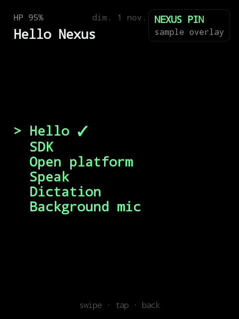

*Live capture: Hello Nexus shows its small pin, then its medium pin.*

## Notice band

A notice is one discrete event: a message, an alert, a question. The platform
draws it as the **band**, a strip across the top of the HUD with an optional
row of up to three actions, and takes it away on its own deadline. The
Assistant's answer band is a notice band too. `NexusNotice`; plan 011. Shown
today by Relay, Assistant, Agents and Hello Nexus.
See [Notice bands](PLUGIN_SDK.md#notice-bands).

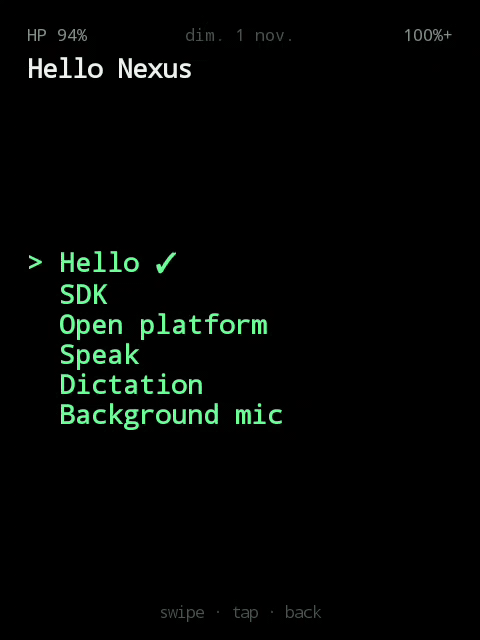

*Live capture: Hello Nexus's demo notice band with its action row.*

## Activity island

The island is the floating form of an activity, drawn by the glasses over
everything, the Rokid home included. It takes no input. Its forms:

- **compact** — folded: a mark (glyph or cover) and two lines.
- **chip** — folded, for an activity with a `measure`: "3 min" over "250 m"
  beside the glyph, the line below kept.
- **panel** — expanded, for the primary activity: large title, progress, ETA, actions.
- **flare** — on a significant update the island springs into the notice-band
  geometry for about 3.5 s, then folds back.
- **pulse** — a minor update swells the outline and lets it spring back.
- **hidden** — while the camera overlay is visible.

Whether and when an island shows is the wearer's
[Floating Activities](#floating-activities-phone) choice, never the plugin's.
`NexusActivity`, `startActivity` / `updateActivity` / `endActivity`;
plans 012 and 023. Shown today by Media Deck, Navigation, Transit and Hello
Nexus's Todo. See [Live activities](PLUGIN_SDK.md#live-activities) and
[BUSSPEC, Platform presentations](../BUSSPEC.md#platform-presentations).

**Compact**

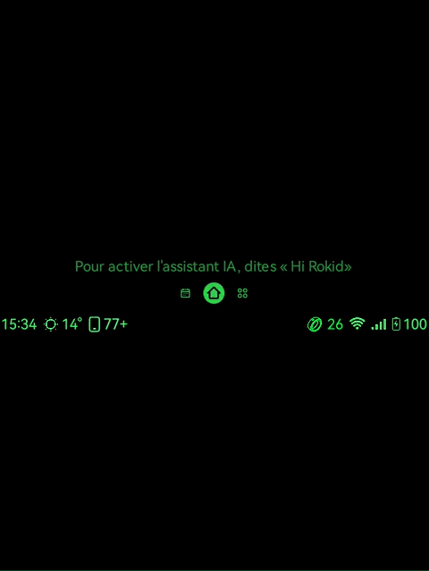

*Reused: Media Deck's compact island on the glasses home, cropped from the
Nexus 2.0 demo.*

A guidance island (Navigation's minimap form) uses the same outline:

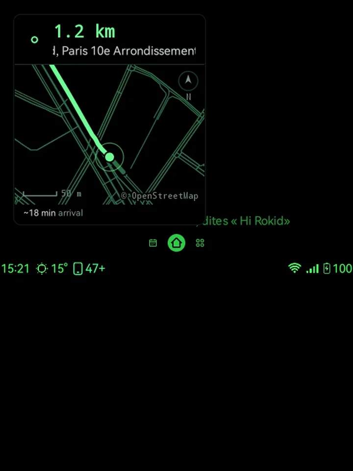

*Reused still.*

**Panel**

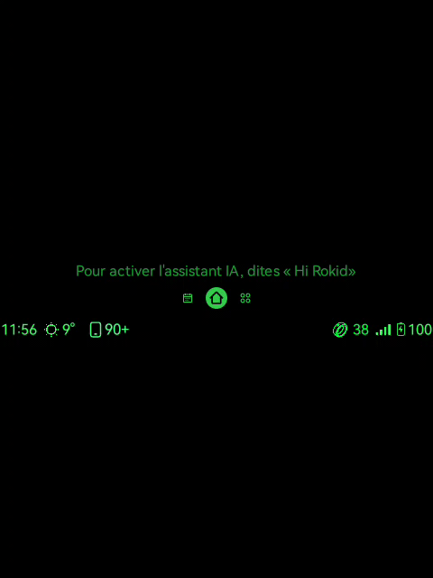

*Live capture: Hello Nexus's demo route starts as the primary activity's
panel and folds about 10 s later.*

**Flare**

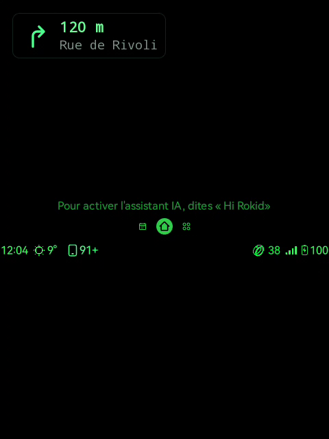

*Live capture: a new step of Hello Nexus's demo route (bus 38, "3 stops")
flares, then folds back to its compact form.*

## Activity card in the launcher

The **launcher** is Nexus's own UI on the glasses, opened with a triple tap:
the activities first, then the latest notification, **Notifications** and
**Applications**. (The protocol calls it a *session*.) Each activity is a
**card** in it: what it is, its state, and up to three commands, previewed on
the card. The card is separate from the island: an island can expire while
its card stays, and with **Keep in activities** turned on in the plugin, the
card even outlives the plugin's connection. Plans 027 and 028. Shown today by
Media Deck, Navigation, Relay and Hello Nexus's Todo.
See [Interactive activities](PLUGIN_SDK.md#interactive-activities-launcher-bundle)
and [User choice: Keep in activities](PLUGIN_SDK.md#user-choice-keep-in-activities).

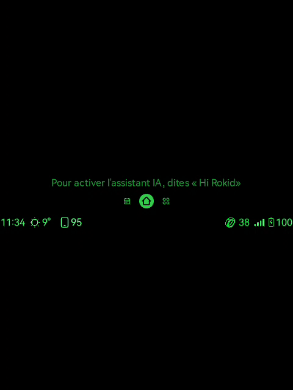

*Live capture: the launcher opening on the Rokid home, Media Deck's card first
(kept offline, so it is marked last known).*

## Page

A page is typed content the glasses hub draws inside the launcher, over
whatever was on screen, from data the plugin sends: a summary, a list, a
document, a conversation, a media player or a route. It never replaces the
screen underneath; BACK returns exactly where the wearer was. A card's tap or
an Applications row opens it. `NexusPage` (`PageBody` templates,
`NexusPageActionSpec`); plans 027 and 028. Shown today by Media Deck, Navigation,
Relay and Hello Nexus. See [Pages](PLUGIN_SDK.md#pages) and
[Templates](PLUGIN_SDK.md#templates).

**Media player page**

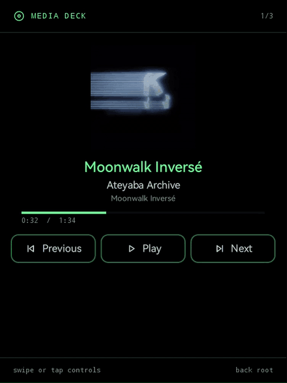

*Reused: Media Deck's player page, cropped from the Nexus 2.0 demo.*

**Route page**

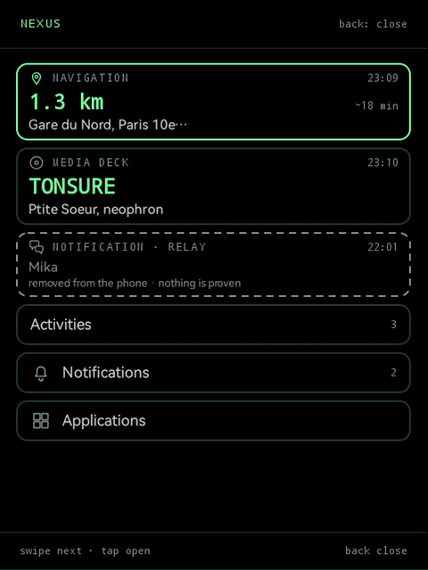

*Reused: the Navigation card opening its route page, cropped from the Nexus
2.0 demo (simulated position).*

**Composer and composer tools**

On a conversation page the hub draws the **composer**: a bar under the bubbles
with **Dictate**, **Type** and, once a draft exists, **Send**. Send is the
hub's and only ever sends text the wearer has seen. A page may add its own
buttons to the bar, the **composer tools** (a **Photo** button, say), hide or
rename Dictate and Type, and order the bar; a tool either runs one of the
page's actions or opens the plugin's immersion with the thread it came from.
A message may carry a **thumbnail**, drawn in its bubble. `ConversationComposer`,
`ComposerTool`, `ComposerSlot`, `ConversationMessage.image`; launcher bundle v5.
See [Composer tools](PLUGIN_SDK.md#composer-tools-launcher-bundle-v5).

## Immersion (Open app)

An immersion is the plugin's own full-screen interaction on the glasses: its
cards, reader, media, image or Ink surfaces, driven by the plugin while it is
open. The wearer reaches it through **Open app**, on a page or in
Applications. In the protocol it is the `IMMERSION` action kind; a
"surface card" is a `NexusCard` shown in it. `NexusSurfaceSession`,
`NexusCard`, `NexusInkSurfaceSession`. Every plugin with a surface has one;
Hello Nexus's Ink page is below. See
[Choosing a HUD kind](PLUGIN_SDK.md#choosing-a-hud-kind) and
[Actions](PLUGIN_SDK.md#actions).

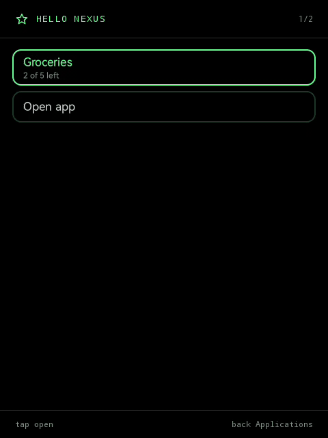

*Live capture: Hello Nexus's page, **Open app**, then its Ink immersion.*

## Floating Activities (phone)

**Floating Activities** is the wearer's per-plugin setting on the phone hub
that drives the island: **Automatic** (the app rules), **Always visible**,
**Home screen only**, **On changes** (the island shows for 3, 5 or 10 s after a
real event, then steps aside) or **Activities only** (card, no island).
Plugins link to it with `NexusUi.activityDisplaySettingsRow` or
`NexusActivityPreference.openDisplaySettings` and mark real events with
`NexusActivity.eventKey`; they never choose the mode or duration. On the wire
it travels in `/core/ambient/policy` as `activityDisplays`. Plan 028 (launcher
bundle v4). Shown today for Media Deck and Hello Nexus's Todo.
See [User-controlled Floating Activities](PLUGIN_SDK.md#user-controlled-floating-activities-launcher-bundle-v4).

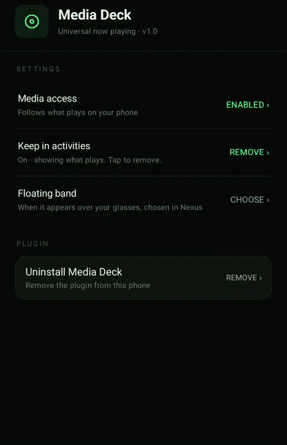

*Reused: the phone hub's Floating Activities screen for Media Deck, cropped
from the Nexus 2.0 demo.*

## Classic launcher (chip and panel)

The **Classic launcher** is the glasses launcher kept with an older phone hub,
an older plugin peer, or when the wearer chooses it on the phone or the
glasses: a plain list of plugins that open their immersions. Without the
launcher bundle there is no Activities card or page, but the island keeps its
forms: the primary activity expands into the **panel**, and a measured one
folds to the **chip**.
See [Pages](PLUGIN_SDK.md#pages).

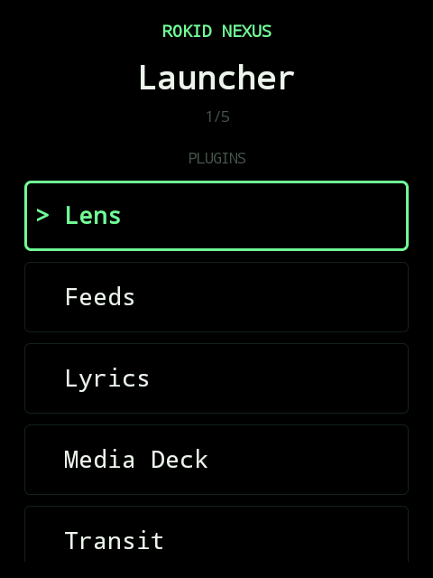

*Reused still of the Classic launcher's plugin list.*

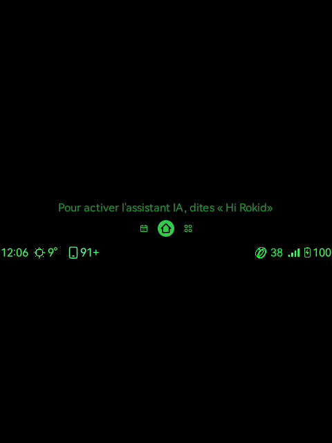

*Live capture, two clips with the Classic launcher chosen on the phone:
Hello Nexus's demo route as a panel, folding; then a walk to the stop ("3 min",
"250 m") flaring and folding to the chip.*
